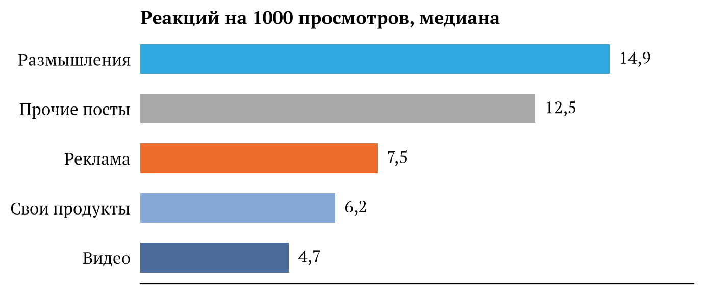
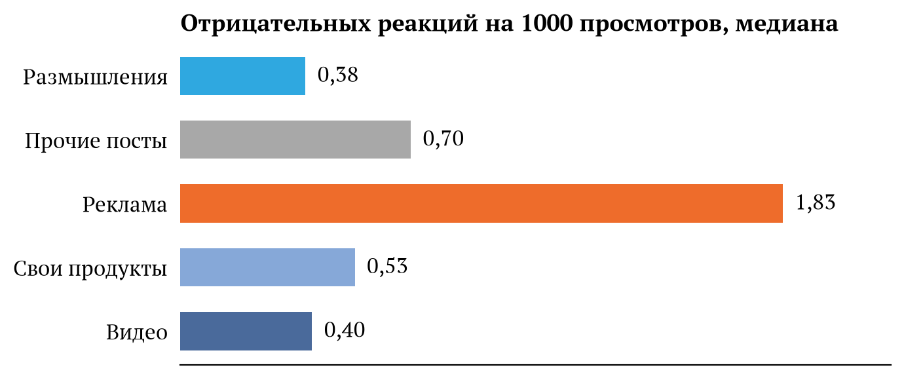
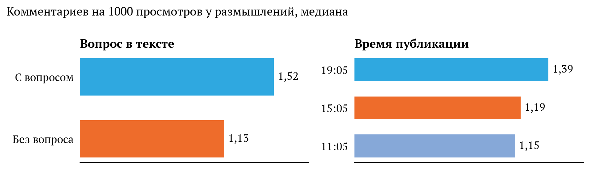
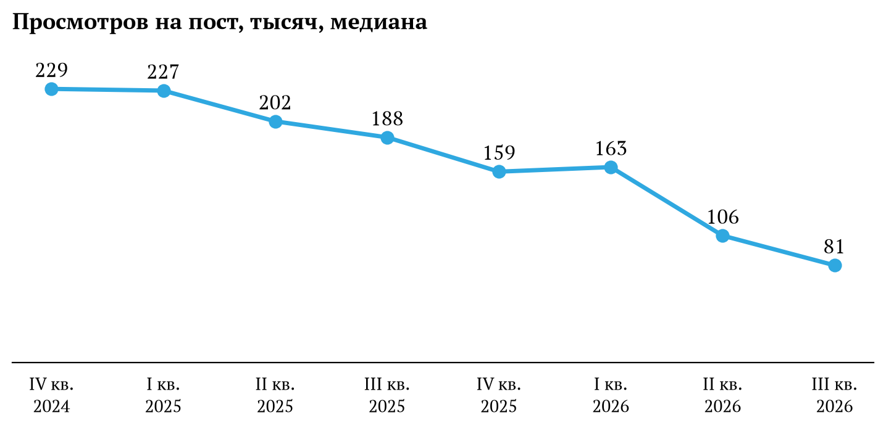

Артемий Андреевич, здравствуйте!

Меня зовут Татьяна Алфёрова, я аналитик данных. Я выгрузила 2279 постов вашего телеграм-канала с октября 2024 по сентябрь 2026 года и посмотрела, от чего зависит, сколько реакций, комментариев и пересылок соберёт пост. Предлагаю вам ознакомиться с результатами моего исследования, которые могут увеличить вовлечённость подписчиков на вашем канале. 

### 1. Больше всего реакций собирают ваши размышления о повседневной жизни

Я разделила посты вашего телеграм-канала на пять типов: размышления (текст с заголовком без ссылок), ссылки на видео с вашим участием, реклама, посты о продуктах вашей Студии и остальные (те, которые нельзя отнести ни к одной группе). Реакций у постов-размышлений больше всего, у рекламы их вдвое меньше, у видео втрое меньше.

Отрицательных реакций у рекламы в 4,8 раза больше, чем у размышлений.

Отдельно я посмотрела посты с «Рекламной супер-ссылкой» в конце. Основной текст у них авторский, но реакций они собирают почти как обычная реклама: 9,1 на 1000 просмотров против 7,2.

### 2. Комментариев больше у размышлений с вопросом и у вечерних постов

Также я заметила, что большинство постов публикуются в конкретные временные слоты: 11:05, 15:05 и 19:05. Размышления, в которых есть вопрос, комментируют на 35% чаще. Размышления, вышедшие в 19:05, комментируют на 21% чаще, чем вышедшие в 11:05. Связь вопроса и времени с реакциями и пересылками не подтвердилась.

### 3. Длинные посты-размышления пересылают чаще

Чем длиннее размышление, тем чаще его пересылают. Короткие (до 414 символов) пересылают на 20–40% реже, чем средние (415–719 символов), а длинные (больше 719 символов) на 21–51% чаще, чем средние. На постах после 27 февраля 2026 года разница в ту же сторону, но слабее, и строгую проверку она не прошла. Поэтому я отношу её к наблюдениям, которые стоит перепроверить.

### 4. Предположения, которые не подтвердились

- День недели и выходные.
- Тема поста: реакции у постов про еду, деньги, путешествия, город и здоровье не различаются.
- Время 15:05. Реакций в 15:05 меньше, но потому, что в это время выходят более короткие тексты: две трети размышлений в 15:05 короче 415 символов. Если сравнивать тексты одной длины, разница пропадает. При этом короткие размышления собирают на 11% меньше реакций, чем средние.
- Мат. Размышления с матом собирают на 8–13% больше реакций. Эта разница прошла проверку на самой границе, и другим методом она не подтверждается, поэтому я на неё не опираюсь.

### Как я проверяла

Различия из пунктов 1 и 2 я проверила моделью, которая учитывает тип поста, время, длину, вопрос, мат и тему одновременно. Эффекты я искала на постах до 27 февраля 2026 года, а затем проверила на более поздних, и все они повторились. С учётом остальных признаков разница по вопросу и времени даже больше: 44–46% и 24–28%. Это связь, причину анализ не показывает. Проверить, что вопрос в тексте или вечернее время действительно добавляют комментариев, можно на практике. Например, месяц ставить одинаковые по длине размышления с вопросом и без в одно и то же время.

### Охват телеграм-канала

За два года медиана просмотров на пост упала в 2,8 раза: с 229 тысяч в конце 2024 года до 81 тысячи летом 2026-го. Все выводы выше посчитаны на 1000 просмотров, то есть показывают, как реагируют на пост те, кто его увидел. Это вовлечённость аудитории, и от падения охвата она почти не зависит. Охват определяется тем, сколько людей вообще видят канал. Почему он падает, по этой выгрузке понять нельзя, так как в ней нет данных о подписках, отписках и источниках читателей. Охват растят привлечением новых читателей, например из ваших аккаунтов в других соцсетях. Это другая задача, и её можно разобрать отдельно.

### Что бы я порекомендовала для повышения вовлечённости

1. **Выпускать рекламу отдельным постом.** Размышления с «Рекламной супер-ссылкой» в конце собирают почти столько же реакций, сколько обычная реклама. Если важно, чтобы читатели реагировали на сам текст, рекламный блок лучше вынести в отдельный пост.
2. **Заканчивать размышление вопросом, если хотите больше комментариев.** Размышления с вопросом комментируют на 35% чаще, чем без него.
3. **Публиковать тексты для обсуждения в 19:05.** Вечерние размышления комментируют чаще. Вечерний пост обычно последний за день и остаётся наверху канала до утра, поэтому по данным нельзя понять, что сильнее влияет на комментарии: время или положение в ленте. На практике это неважно, так как в обоих случаях достаточно публиковать такой текст вечером.
4. **Постить 15:05 не только короткие тексты.** Днём посты-размышления собирают на 11% меньше реакций, чем утром и вечером, но только потому, что в 15:05 обычно выходят короткие тексты. Среди текстов одинаковой длины разница почти исчезает. 

Код и подробности — в ноутбуке: [github.com/alferova-tv/data_analytics_projects](https://github.com/alferova-tv/data_analytics_projects/tree/main/lebedev_tg_research).

С уважением
Алфёрова Татьяна
